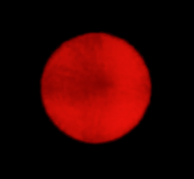

# quantum-relativity

A hobby simulation of one person's theory of how space, matter and forces could come from a single
kind of stuff: energy. The goal is not to replace quantum physics or relativity, but to see whether
these rules, run on a computer, produce things we know from nature: gravity, expansion, black holes,
orbits.



*One energy volume in the viewer: a swirl of energy.*

## The seven axioms

Everything in the simulation has to follow from these seven sentences, and from nothing else.

1. **Energy**: an always-moving quantum fluid, one whole signed number of quanta per Planck box at each
   moment of local time. The total is not fixed: a squeezed joint makes more minus energy out of itself,
   and when a joint collapses its minus energy flips to plus and joins the volumes beside it. Zero is empty space, which does nothing.
2. **Cells are swirls**: plus only pulls, minus only pushes, both oscillate in whole steps. Energy is how
   fast a swirl turns: more energy, faster turn, smaller cell; plus and minus are the two directions of
   the turn. Swirls turning the same way want to merge, which is the pull, but two turning the same way
   would grind where they touch; so a swirl turning the other way, a joint, lies between them and they
   mesh like gears. The swirl's empty core is a ring closed inside the cell, not a pipe.
3. **Structure**: plus never touches plus; minus wraps every plus and forms one web. The cells are the
   grid, a perfect A B A B pattern. A cell has no geometry of its own, only relations to its neighbours
   and a size set by its energy alone: more energy, smaller, for energy volumes and joints alike. Lumps
   warp the grid by making their cells small. Planck boxes are not space: they sit inside each cell only
   to compute its fluid.
4. **Crossing**: energy diffuses between plus swirls only through minus; that is the only friction, and
   what friction holds back stays as energy in the volume it came from.
5. **Packing**: more packed is smaller, slower and pulls harder; pull spreads at a finite speed, weaker
   with distance; squeezed minus pushes back steeply.
6. **Limits**: a joint's energy rises only while it is squeezed, so a fresh joint is the fattest it will
   ever be and shrinks as it is squeezed; it collapses only past a limit, where the pull across it is so deep that
   nothing moving at the top speed could climb out (a black hole opening): its minus energy flips to plus
   and it merges with the pulling volumes beside it into one, so the collapse can spread; a volume's leaking outside tears off as a layer of new volumes.
7. **Quantum**: each box's fluid also carries a phase, so waves add and cancel. Moving energy can split
   over several routes at once. Every split gets a direct pull between its halves, private to them, and
   its own oscillation. When something reacts with a half, or the energy loses its momentum, it settles
   whole in one cell.

In pictures: an **energy volume** (plus, drawn red) is a round swirl of energy, like the inside of a living
cell; the **joints** (minus, drawn blue) are volumes squeezed between the energy volumes that pull across
them, thin between two and fat where several meet.

The full wording, the open problems and the plan are in the bible chapter
[`physics/quantum-relativity`](docs/bible.md#physicsquantum-relativity); the words used are defined in
[`CONTEXT.md`](CONTEXT.md).

## Status

Early, and started afresh on 2026-11-18: the engine before had grown too big and basic gravity still did
not work. The new one is small, built for a billion cells from the start, and grows in layers, each one
something to look at. Built so far: one energy volume whose fluid turns as one whole swirl with an
open core, every quantum counted exactly; energy crossing from volume to volume through a joint, and
the squeeze; a universe that grows from one energy volume, whose whirl leaks: what leaks tears off as a
layer of new volumes all round it, with joints between, and those shed the next layer; and one pull,
a number a cell that every energy volume feeds and every cell hands on to its neighbours a step at a
time, which squeezes the joints and bends crossing energy toward where it is deeper. Layer 5 (2026-11-19): a
volume's leak never takes more than a seventh of it in a turn, and two joined volumes stand their half
widths and the joint's thickness apart, so they cannot overlap. A cell is three ring whirls, one for
each direction, round an empty core closed inside the cell; it turns in step with its energy, a joint
turns the other way and meshes with its volumes like a gear, and nothing is drawn by chance.

Since 2026-11-19 the leak and the crossing are two separate things. The leak always happens: every
whirl sheds a small share of itself to every side, whatever its neighbours hold. Beyond that, energy
crosses a joint only where something drives it: the pull, toward the deeper side, or the fluid's own
motion. Two volumes that merely hold different amounts no longer even out. Measured: at three layers
113 of 118 volumes are whole whirls (2 of 85 before), at six 779 of 920; the first volume keeps its
energy (1,616 of 1,657 calm volumes at three layers), so the universe grows by its leak alone and far
slower: three layers take 53 turns where they took 6.5. A region made fuller by hand now keeps 98% of
what it was given after half a turn (24% before) and 95% after a turn.

A joint collapses past one limit that is the same everywhere: where the pull at both its volumes is so
deep that nothing at the top speed (one fixed speed, 110 calm lengths a turn, chosen) could climb out.
It flips to plus where it stands and its two volumes and it are one; every cell keeps its place, so the
grid beyond does not move (under 1% two cells out). Out of a volume past the limit nothing leaves, by
the leak or the crossing, so a collapsed region keeps its energy and takes in what reaches it. In a
grown universe nothing is as deep as the first volume, and that is under the limit: no collapse in nine
layers. `--scene hole` stages one: a packed middle gives way in under a turn, six joints, thirteen cells,
and holds its energy for 20 turns (12,425 calm volumes, then 12,429); fed, it grows to 49 cells.

Since later that day energy carries its motion with it when it crosses a joint, and meets the joint's
resistance at each crossing: a volume's fluid has one flow a direction, what crosses takes its share
along and arrives still going, what friction holds back stays where it was, and the pull adds to the
flow toward the deeper side. In a calm line of eleven volumes (`--scene gather`, `--scene coast`) a
volume 4 times fuller gathers from its neighbours (4.0 to 6.29 calm volumes in 8 turns) and one set
going travels six volumes in 8 turns as a body.

Not right yet: that holds in a hand-laid line only. In a grown universe the first volume is set going
by its own pull handed back through its lopsided surroundings and pours out (1,632 calm volumes at 10.9
turns, 332 at 13.8), so no region made fuller there holds, two do not draw together, half the volumes
are no whole whirls any more and of the hole scene's six joints only two fall; two lumps in the line
do not draw each other either, because there the pull fades to a tenth with every volume; the fall
fades as distance to the power -0.87, not -2; and by the limit as built no black hole forms in a grown
universe, which the owner must rule on. Progress is tracked on
[issue #1](https://github.com/JoeyKardolus/quantum-relativity/issues/1).
Misses are reported as misses; nothing is tuned to look good.

## Run it

```bash
uv sync --all-packages --all-extras --all-groups
PYTHONPATH=. .venv/bin/python -m physics.view   # one cell; Up Down energy, F sign, 1 2 3 0 rings, Space, R, Esc
PYTHONPATH=. .venv/bin/python -m physics.view --scene crossing   # a volume, a joint, a volume: the leak passes slowly; M sets the first one's fluid going
PYTHONPATH=. .venv/bin/python -m physics.view --scene grow       # one volume leaks and sheds layer after layer of new volumes; X Y Z look along, C whole or flat cut
PYTHONPATH=. .venv/bin/python -m physics.view --scene hole       # a packed middle collapses, keeps what it holds and takes in more
PYTHONPATH=. .venv/bin/python -m physics.view --scene lumps      # two regions made fuller by hand in a small grown patch
PYTHONPATH=. .venv/bin/python -m physics.view --scene gather     # a line of volumes: the fuller one gains from its neighbours
PYTHONPATH=. .venv/bin/python -m physics.view --scene coast      # a line of volumes: a fuller one set going travels down it
PYTHONPATH=. .venv/bin/pytest -q physics                     # the tests, about 40 seconds
```

Needs Linux or WSL2, Python 3.12+, [`uv`](https://docs.astral.sh/uv/) . The engine runs on
[NVIDIA Warp](https://github.com/NVIDIA/warp): on an NVIDIA GPU when there is one, else on the CPU. On WSL2 the viewer switches the window's drawing
to the GPU by itself.

| Path | What it is |
|---|---|
| `physics/engine/` | the engine, one directory per axiom (`axiom_1_energy` to `axiom_7_quantum`), each with its definitions, its logic and its tests; the layers so far fill the first six |
| `physics/view/` | the window on one red energy volume with its swirl, on a volume, a blue joint and a volume with energy crossing, or on a ball of cells growing layer by layer from one volume's leak; it can also save pictures |
| `docs/bible.md` | how everything works; the theory is the chapter `physics/quantum-relativity` |

## Built with

Written with Claude Code on [babon-harness](https://github.com/Babon-Innovations-b-v/babon-harness), a
Claude Code setup whose skills, hooks and code index live in `.claude/`. 

## Licence

MIT. See [`LICENSE`](LICENSE).
